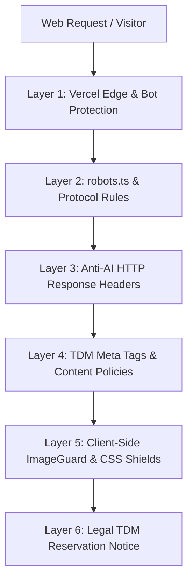

# AI Protection, Anti-Scraping & Image Security Documentation

*A comprehensive technical guide to the multi-layered defense system implemented across Dani's Stills to prevent unauthorized AI training, bot scraping, and automated image downloads.*

---

## 1. Multi-Layered Defense Architecture

Because no single mechanism can completely stop all actors on the open web, the portfolio uses a **Defense-in-Depth** model across protocol, network, server, client, and legal layers.



---

## 2. Implemented Codebase Protections

### A. AI Crawler & Scraper Disallow Route (`src/app/robots.ts`)
* **File:** [`src/app/robots.ts`](src/app/robots.ts)
* **Status:** Active (Build-time Static Route)
* **What it does:** Explicitly denies access to known AI model training bots, scraping engines, and data collection crawlers while allowing regular search engine crawlers (Google, Bing) for organic portfolio discovery.

**Blocked Crawlers include:**
* `GPTBot`, `ChatGPT-User` (OpenAI)
* `CCBot` (Common Crawl foundation datasets)
* `Google-Extended` (Gemini & Vertex AI model training)
* `ClaudeBot`, `anthropic-ai` (Anthropic Claude)
* `Bytespider` (ByteDance / TikTok AI)
* `FacebookBot`, `meta-externalagent` (Meta Llama & AI)
* `Applebot-Extended` (Apple Intelligence training)
* `PerplexityBot`, `cohere-ai`, `Diffbot`, `ImagesiftBot`, `Omgilibot`, `Scrapy`, `Amazonbot`, `YouBot`, `Timpibot`, `VelenPublicWebCrawler`

---

### B. Anti-AI HTTP Response Headers (`next.config.ts`)
* **File:** [`next.config.ts`](next.config.ts)
* **Status:** Active
* **Headers Injected:**
  * `X-Robots-Tag: noai, noimageai` — Instructs compliant crawlers not to use images or text for AI training.
  * `X-Content-Type-Options: nosniff` — Prevents MIME-type sniffing exploits.
  * `Referrer-Policy: strict-origin-when-cross-origin` — Protects internal asset paths.

---

### C. TDM Rights Reservation & Metadata (`src/app/layout.tsx`)
* **File:** [`src/app/layout.tsx`](src/app/layout.tsx)
* **Status:** Active
* **What it does:** Uses standard W3C and EU Directive 2019/790 (Article 4) Text and Data Mining (TDM) reservation declarations in the document head:
  * `<meta name="tdm-reservation" content="1" />`
  * `<meta name="tdm-policy" content="https://www.w3.org/community/tdmrep/" />`
  * `<meta name="robots" content="noai, noimageai" />`
  * Next.js metadata `robots.noimageindex: true`

---

### D. Global Client-Side Image Shield (`src/components/image-guard.tsx` & `src/app/globals.css`)
* **Files:** [`src/components/image-guard.tsx`](src/components/image-guard.tsx), [`src/app/globals.css`](src/app/globals.css)
* **Status:** Active
* **What it does:**
  1. **Right-Click Interception:** Globally intercepts `contextmenu` events on all ``, `<picture>`, and `[data-protected-image]` elements to prevent the default browser "Save Image As..." action.
  2. **Anti-Drag:** Intercepts `dragstart` to prevent users from dragging photos directly to the desktop or folder.
  3. **CSS Safeguards:** Enforces `-webkit-user-drag: none`, `user-drag: none`, `-webkit-touch-callout: none`, and `user-select: none`.

---

### E. Component-Level Viewer Protections
* **Files:**
  * [`src/components/lightbox.tsx`](src/components/lightbox.tsx)
  * [`src/components/photo-card.tsx`](src/components/photo-card.tsx)
  * [`src/components/collage-grid-viewer.tsx`](src/components/collage-grid-viewer.tsx)
* **What it does:**
  * Injects transparent overlay click shields (`absolute inset-0 z-10 bg-transparent`) directly over high-res viewer canvases.
  * Explicitly passes `draggable={false}` and `pointer-events-none` on photo elements.

---

### F. Legal Copyright & TDM Reservation
* **Files:**
  * [`src/app/page.tsx`](src/app/page.tsx)
  * [`src/app/about/page.tsx`](src/app/about/page.tsx)
  * [`src/app/how-it-works/page.tsx`](src/app/how-it-works/page.tsx)
* **Footer Statement:**
  > *© {Current Year} Daniel García. All Rights Reserved. • No AI Training / Text & Data Mining Reserved*

---

## 3. Edge & Hosting Protections (Vercel & Cloudflare)

### Vercel Security Settings (Enabled)
1. **Bot Protection & AI Bot Challenge:** Enabled under Vercel Project Settings $\rightarrow$ Security. Challenges or blocks known automated scrapers and bad bots before they hit serverless compute.
2. **Attack Challenge Mode:** Challenges suspicious volumetric scrapers.

### Cloudflare R2 Bucket Security Best Practices
* **Disable Public Bucket Listing (`ListObjects`):** Ensure the R2 bucket only allows `GetObject` for direct keys and disallows bucket enumeration.
* **Web-Optimized Derivatives:** The upload pipeline in [`src/app/api/upload/route.ts`](src/app/api/upload/route.ts) converts files to optimized WebP format (max 2048px width, 80% quality) rather than exposing uncompressed RAW/TIFF master files.

---

## 4. Future Roadmap: Automated Cloud GPU Poisoning (Glaze / Nightshade)

*(Deferred for future implementation)*

When ready to implement adversarial cloaking, the following architecture can be deployed:

### Summary of Future Architecture
* **Technology:** [Modal.com](https://modal.com) Serverless Python Worker with NVIDIA A10G / T4 GPU.
* **Algorithms:**
  * **Glaze Equivalent:** CLIP image embedding cosine similarity disruption (prevents AI style cloning).
  * **Nightshade Equivalent:** Projected Gradient Descent (PGD) against Stable Diffusion VAE latent representations (poisons semantic concepts).
* **Cost:**
  * Processing time: ~5–10s per photo on GPU.
  * Pay-as-you-go: ~$0.003 to $0.005 per photo.
  * Modal provides a **$30/month free tier**, making it practically $0 for portfolio workloads.

### Reference Python Engine Implementation (For Future Activation)

```python
# modal_cloak_service.py (Future Reference)
import modal
import torch
import torchvision.transforms as T
from PIL import Image
from diffusers import AutoencoderKL
from transformers import CLIPVisionModelWithProjection

app = modal.App("photography-cloak-service")
image = modal.Image.debian_slim().pip_install(
    "torch", "torchvision", "diffusers", "transformers", "accelerate", "Pillow"
)

@app.function(image=image, gpu="A10G", timeout=120)
@modal.web_endpoint(method="POST")
def cloak_image(payload: dict):
    # Receives image, computes adversarial perturbation, returns protected buffer
    pass
```

---

## 5. Verification & Testing

| Feature | How to Test | Expected Result |
| :--- | :--- | :--- |
| **Robots Route** | Visit `/robots.txt` in the browser | Returns user-agent disallow list for all AI bots |
| **HTTP Headers** | Run `curl -I https://yourdomain.com/` | Includes `X-Robots-Tag: noai, noimageai` |
| **Right-Click Shield** | Right-click any photo in the gallery or lightbox | Context menu is prevented |
| **Drag Shield** | Click and drag photo towards desktop | Photo cannot be dragged or dropped |
| **Vercel AI Bot Block** | Verified in Vercel Security Dashboard | Automated AI crawlers receive 403 or managed challenge |
